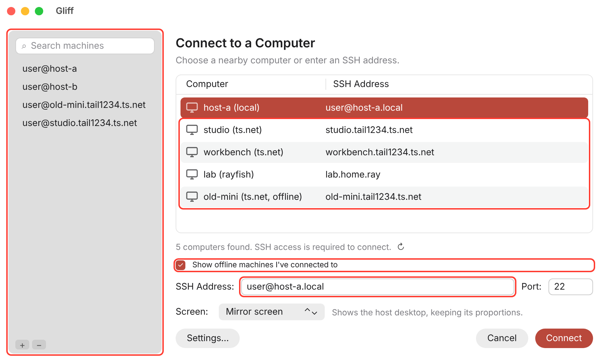
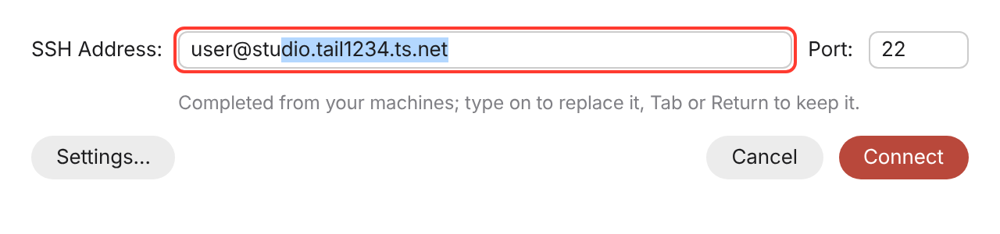
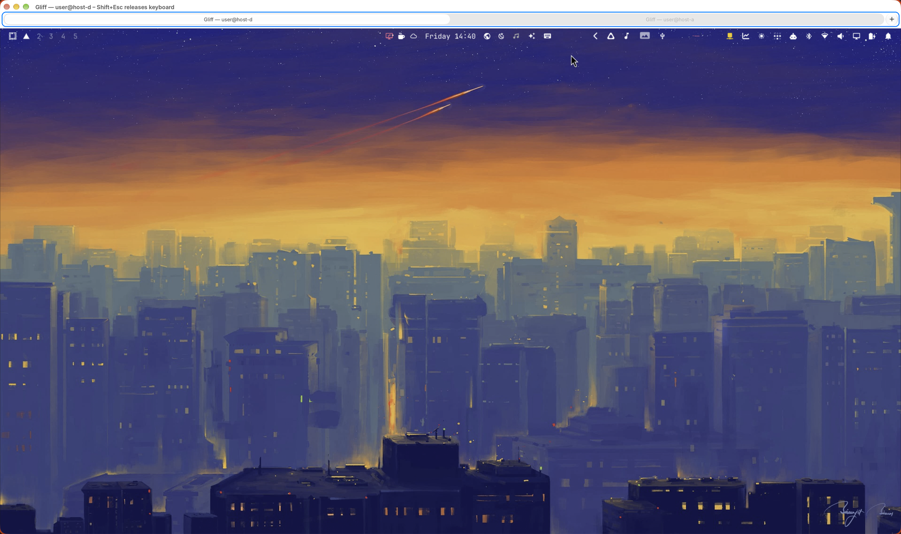
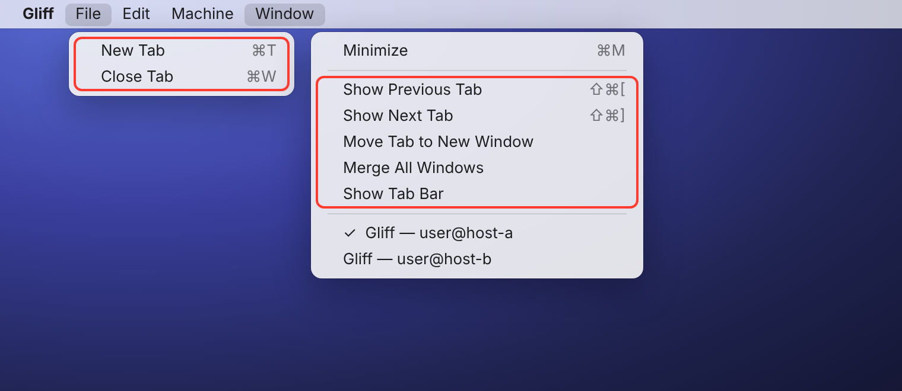
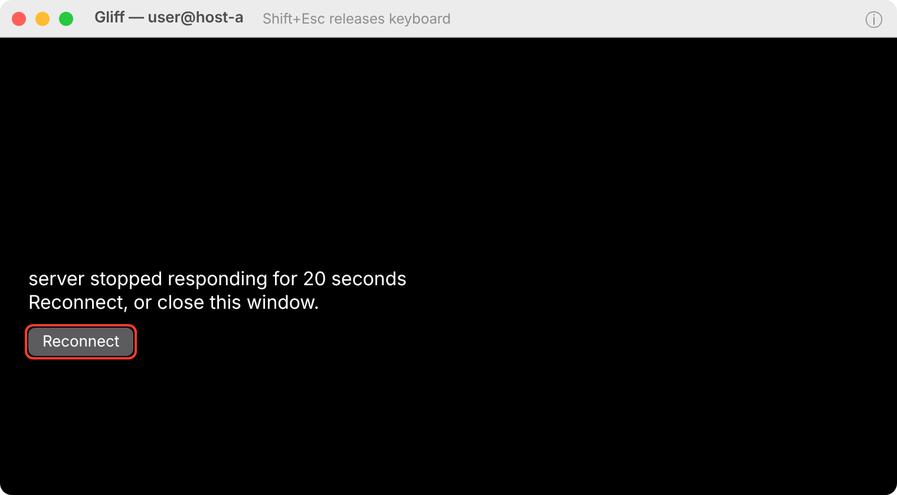
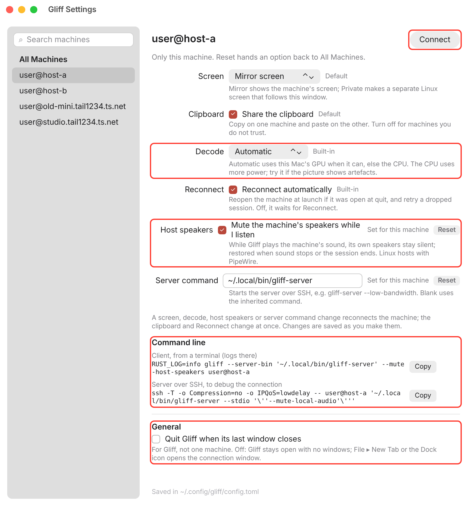
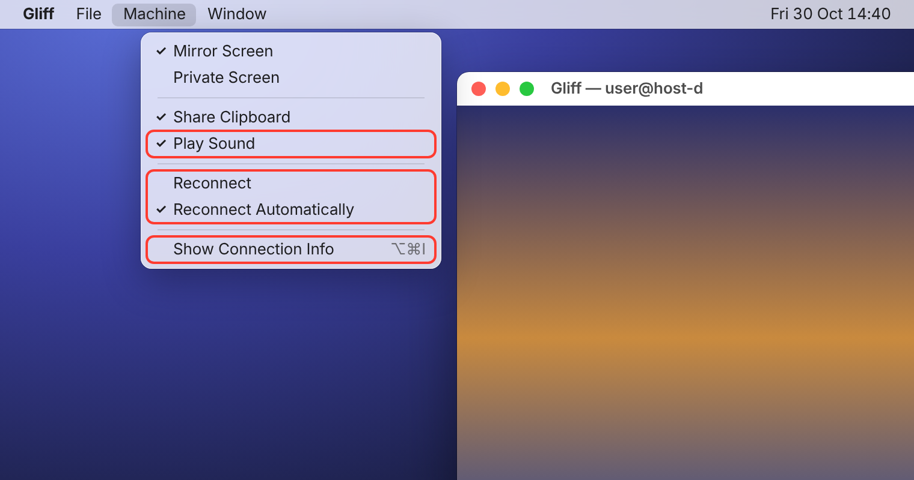

# gliff fork news

**Fork:** [LaurentFough/gliff](https://github.com/LaurentFough/gliff), branch `acrogenesis/macos-client-host`. Built on acrogenesis' macOS client and host (upstream #47).

A quick look at what this fork adds. The README carries the same list; [ToDone.md](ToDone.md) has the full state, pending work and a log of every commit and merge.

## Upstream PRs included

- **#47**: native macOS client and host, LAN discovery (acrogenesis). The base of the fork.
- **#98**: settings window and per-machine tab menu. Merged, and brought to the Mac client.
- **#80**: sound from Linux hosts (Opus over the existing connection). Merged.
- **#5**: dhh's macOS client. Only its VideoToolbox + Metal video path, ported into #47's viewer.

## Fork features

- **Tabs on the Mac**: every connection is a native macOS tab in one viewer. The tab bar's **+** or File ▸ New Tab adds a machine; tabs stay connected, only the visible one plays sound, and open tabs reopen at launch. *(Tested.)*
- **Known machines in the connection window**: a sidebar lists every machine you have connected to (searchable, **+** to add one, **−** to forget one), and the SSH Address field autocompletes from them, at launch and for File ▸ New Tab. *(Tested.)*
- **Per-machine auto-reconnect**: Machine ▸ Reconnect Automatically, or Reconnect in Settings on both clients (`auto_reconnect`; Settings ▸ Reconnect on Linux). Off, the machine is not reopened at launch and a dropped session waits for Reconnect. *(Tested.)*
- **One app on the Mac**: Settings and the connection window (at launch and File ▸ New Tab) open inside the viewer (one Dock icon and ⌘-Tab entry, one menu bar from the start; Settings' Connect also answers an open connection window). *(Tested 2026-11-04.)* New Tab is a sheet over a tab that is not connected, else its own window; ⌘, brings an open Settings forward, and Settings can **Connect** a machine (or double-click it) in a new tab. The connection window's list grows with the window. *(Tested.)*
- **Quit on last window, and About**: Settings ▸ General ▸ Quit Gliff when its last window closes (`quit_on_last_window`, default off: Gliff stays open, and ⌘T or the Dock icon opens the connection window). Gliff ▸ About Gliff shows the version and build (commit, arch). *(Tested.)*
- **Reconnect on the Mac**: a dropped or failed session shows a **Reconnect** button; sessions that had connected retry automatically (5 × 1.5 s, as on Linux), without repeating SSH prompts. *(Tested.)*
- **GPU video on the Mac viewer**: VideoToolbox hardware H.264 decode, Metal 4:4:4 recombine, `CAMetalLayer` presentation; asks for 4:4:4 first, falls back to OpenH264 (`--video cpu` forces it). 4K 4:4:4: about 6.9 ms per frame on the GPU vs 18.8 ms on the CPU.
- **Sound from a Mac host**: a Mac host sends what it plays (ScreenCaptureKit system audio, coded as Opus on #80's wire) while a client plays it; Linux and Mac clients hear it. *(Tested 2026-11-04: Mac → Mac and Mac → Linux.)* With Host speakers, the Mac host mutes its own output while the client listens. *(New; testing pending.)*
- **SSH user**: a per-machine (or default) `ssh_user` in both clients' Settings, used for an address without `user@` (mesh machines report none); mesh rows also take the user of a known `user@host` machine. *(Tested 2026-11-04.)*
- **Machines in Mac Settings**: **+** / **−** under the Settings list add a machine by its SSH address or forget one; **Connect** shows a machine's tab when it is already open. *(Tested 2026-11-04.)*
- **Decode in Mac Settings**: Settings ▸ Decode per machine: Automatic, GPU (VideoToolbox + Metal) or CPU (OpenH264), the client's `--video`. *(Tested 2026-11-03.)*
- **Connection Info on the Mac**: the ⓘ title-bar button or Machine ▸ Show Connection Info (⌥⌘I) shows a translucent panel over each tab: stream size and colour, GPU/CPU tiers, fps, Mbit/s, decode time, round trip, sound buffer, and the client's and viewer's CPU use. *(Tested 2026-11-03.)*
- **Sound on the Mac viewer**: plays Linux hosts' sound through #80's `gliff-audio` (CoreAudio). **Machine ▸ Play Sound** shares the Linux client's mute switch; `--no-audio` starts muted.
- **Host speaker mute**: `gliff-server --mute-local-audio` mutes the Linux host's speakers while the client plays, and restores them on stop, disconnect or crash. Per machine in Settings on both clients (`mute_host_speakers`). *(Tested.)*
- **Shared settings**: a `gliff-settings` crate; both clients read and write `~/.config/gliff/config.toml`. On the Mac: a settings window (⌘,) and a Machine menu. Both settings windows offer Reconnect, Host speakers and the Command line.
- **Local signing**: no paid Apple Developer account needed (a self-signed `gliff-local` identity), so privacy permissions survive rebuilds.
- **Makefile**: one front end for `bin/` and `scripts/`. `make macos` builds, signs, installs and verifies; `make install` on Arch; also `make check`, `make video-check` and `make distclean`; a project-wide `.gitignore`.
- **Build once, install on other Macs**: `make install` skips an unchanged build (a build ID in the app); `make install-package` installs a ZIP from another Mac and re-signs it locally; `make release-upload` / `make install-release` carry it through GitHub Releases. Apple Silicon. *(Tested.)*
- **Build once, install on other Arch/Omarchy machines**: the same `make package` / `install-package` / `release-upload` / `install-release` with a pacman package (`PKG=`, `linux-COMMIT` releases); `make install` skips an unchanged build. *(Tested.)*
- **Command line in Settings**: each machine's client command (`RUST_LOG=info gliff [flags] user@host`) and the exact ssh server command, with Copy, in both clients' Settings, for running or debugging a connection from a terminal; new `--mute-host-speakers` flag. *(Tested.)*
- **Mesh VPN machines**: peers from Tailscale/Headscale and Rayfish, for hosts mDNS cannot reach: listed as `hostname (ts.net)` / `hostname (rayfish)` in the Mac connection window after the nearby `hostname (local)` computers, and in a menu by the Linux address bar; choosing one connects. Online machines only, with a "Show offline machines I've connected to" checkbox; `gliff --mesh` prints a table (`--offline`, `--json`). *(Tested.)*
- **Releases built by CI**: `make release-ci` runs the fork's "Fork builds" workflow on GitHub Actions for the pushed branch (checks, Mac ZIPs for Apple Silicon and Intel, the Arch package) and publishes one `build-COMMIT` pre-release that `make install-release` finds on either system. *(New; the first run passed: `build-3c21faa38975`. Installing from it is still to test.)*
- **Checks**: `make video-check` checks GPU output against the CPU decoder and benchmarks both; the ssh login-shell test no longer depends on your shell setup; `scripts/check.sh` stops early on a Rust older than `rust-version` (1.87); `rust-toolchain.toml` pins Rust 1.99.0 for rustup; the Mac crate is clippy-clean on Linux too (as CI lints it).
- **Fixes**: Mac install and signing (`plutil`, a custom cargo `target-dir`); the client ignores stray sound packets from a host; Arch installs run `pacman -U` through doas, sudo or su (`GLIFF_AUTH`, else `PACMAN_AUTH`); the Arch package tells you to run `gliff-enable-discovery`, which nearby-computer discovery needs.
- **Planned**: an iOS/iPadOS client; see [docs/feature-future/ios-ipados-plan.md](docs/feature-future/ios-ipados-plan.md). Several clients on one desktop (hardening, view-only, a shared stream); see [docs/feature-future/multi-client-plan.md](docs/feature-future/multi-client-plan.md).

## Screenshots

The new features are outlined in red. The connection and Settings windows are rendered mockups drawn to match the code (`docs/images/src/`), with placeholder machines.

**Connection window:** known machines in a sidebar (search, **+** to add, **−** to forget); the SSH Address field autocompletes from them. Mesh peers (Tailscale/Headscale `ts.net`, Rayfish) are listed by hostname with their source, and **Show offline machines I've connected to** adds known peers that are offline.



**Address autocomplete:** typing completes from your machines (the newest match), with the added part selected: type on to replace it, Tab or Return to keep it.



**Tabs:** this shows two tabs in one window, one connection each (outlined separately). Any number of tabs is supported: **+** or File ▸ New Tab opens another connection.



**File and Window menus:** New Tab (⌘T) and Close Tab (⌘W); Show Previous/Next Tab, Move Tab to New Window, Merge All Windows and Show Tab Bar. (Both drawn open here; macOS opens one at a time.)



**Reconnect:** a dropped session that could not be resumed (or with Reconnect Automatically off) waits with the error and a **Reconnect** button.



**Settings:** per machine, or for all machines: **+** / **−** to add a machine by its SSH address or forget one, **Connect** from the selected machine (or show its tab when it is open), **Decode** (Automatic, GPU or CPU), **SSH user** (the login for an address without `user@`, such as a mesh machine), **Reconnect automatically**, **Host speakers** (mute the machine's speakers while you listen), the **Command line** that reproduces the machine's settings (client and server over SSH, each with Copy), and **General ▸ Quit Gliff when its last window closes**.



**'Machine' menu:** Play Sound, Reconnect, Reconnect Automatically and Show Connection Info (⌥⌘I).



## Status

| Path | State |
|---|---|
| Linux host → Mac client | Tested: GPU video, sound, host mute |
| Mac tabs: several connections at once | Tested (2026-10-30) |
| Mac tabs: sound, clipboard, Machine menu, Window menu, restore at launch | Tested (2026-10-30) |
| Mac reconnect | Tested (2026-10-30) |
| Known machines (sidebar, + / −, autocomplete) | Tested (2026-10-30) |
| Per-machine auto-reconnect | Tested on the Mac and Linux (2026-10-31) |
| #98 settings on the Linux client | Tested (2026-10-31) |
| Mac: Settings and New Tab in the viewer, Connect from Settings | Tested (2026-10-31) |
| Mac: quit on last window, About Gliff | Tested (2026-10-31) |
| Mac discovery (Bonjour) | Tested (2026-10-30); the host must run `gliff-discovery` (`gliff-enable-discovery`) |
| Linux host → Linux client sound | Tested (2026-10-31) |
| Build once, install elsewhere: Mac and Arch/Omarchy | Tested (2026-10-31) |
| Host speakers setting, Reconnect in the Linux settings | Tested (2026-11-01) |
| Command line in Settings | Tested (2026-11-02) |
| Mesh VPN machines (Tailscale/Headscale, Rayfish), `gliff --mesh` | Tested (2026-11-03) |
| Releases built by CI (`make release-ci`) | First run passed (all three packages published); `make install-release` not tested yet |
| Intel Mac packages | Built by CI; not tested on an Intel Mac |
| SSH user, Settings + / −, Connect to an open tab | Tested (2026-11-04) |
| Decode in Mac Settings | Tested (2026-11-03) |
| Connection Info overlay (Mac) | Tested (2026-11-03) |
| Sound from a Mac host | Tested Mac → Mac and Mac → Linux (2026-11-04); Host speakers on a Mac host: testing pending |

Feedback and issues welcome on the fork.

## References

```bibtex
@misc{gliff_upstream,
  title        = {omacom/gliff: Hyprland remote desktop over ssh},
  author       = {{omacom}},
  howpublished = {\url{https://github.com/omacom/gliff}}
}
@misc{gliff_pr47,
  title        = {omacom/gliff pull request 47: macOS client and host},
  author       = {{acrogenesis}},
  howpublished = {\url{https://github.com/omacom/gliff/pull/47}}
}
@misc{gliff_pr5,
  title        = {omacom/gliff pull request 5: native macOS client},
  author       = {Heinemeier Hansson, David},
  howpublished = {\url{https://github.com/omacom/gliff/pull/5}}
}
@misc{gliff_pr98,
  title        = {omacom/gliff pull request 98: settings window and per-machine tab menu},
  howpublished = {\url{https://github.com/omacom/gliff/pull/98}}
}
@misc{gliff_pr80,
  title        = {omacom/gliff pull request 80: sound from Linux hosts},
  howpublished = {\url{https://github.com/omacom/gliff/pull/80}}
}
```
