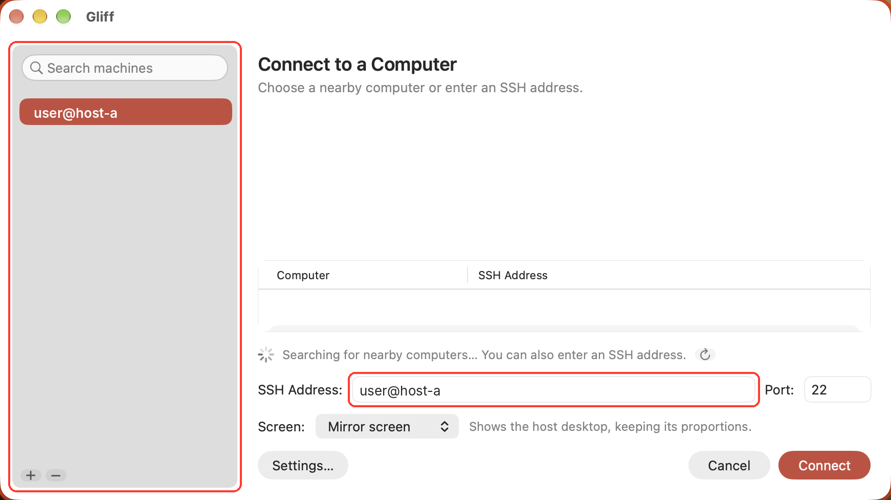
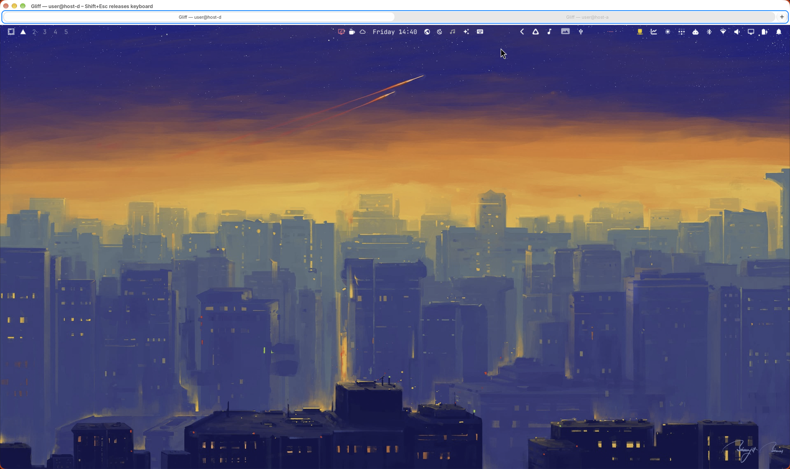
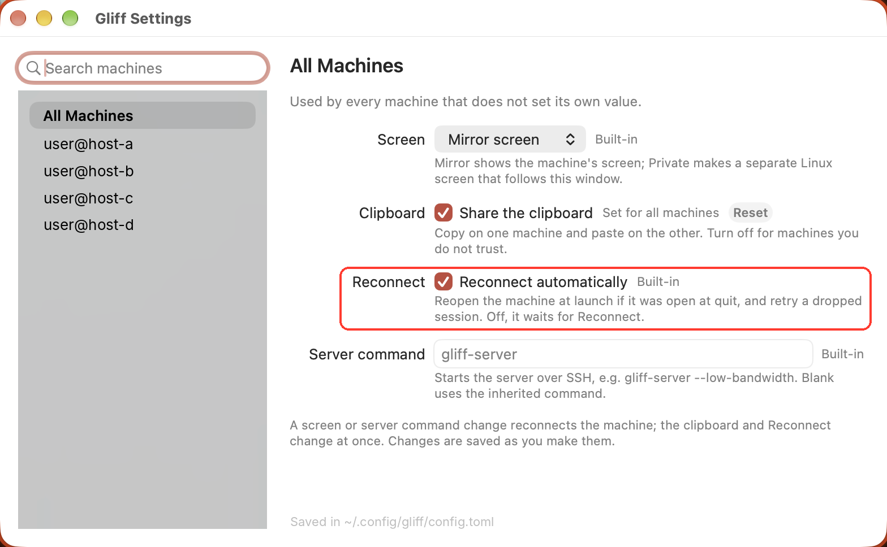
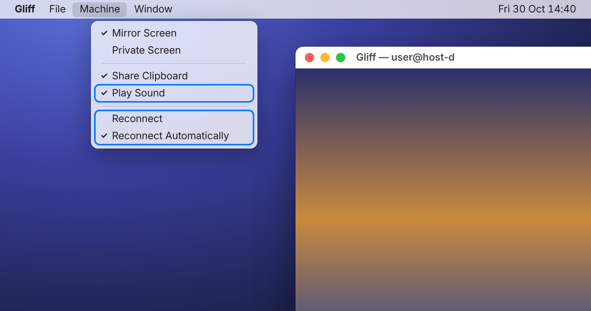

# gliff fork news

**Fork:** [LaurentFough/gliff](https://github.com/LaurentFough/gliff), branch `acrogenesis/macos-client-host`. Built on acrogenesis' macOS client and host (upstream #47).

A quick look at what this fork adds. The README carries the same list; [ToDone.md](ToDone.md) has the full state, pending work and a log of every commit and merge.

## Upstream PRs included

- **#47**: native macOS client and host, LAN discovery (acrogenesis). The base of the fork.
- **#98**: settings window and per-machine tab menu. Merged, and brought to the Mac client.
- **#80**: sound from Linux hosts (Opus over the existing connection). Merged.
- **#5**: dhh's macOS client. Only its VideoToolbox + Metal video path, ported into #47's viewer.

## Fork features

- **Tabs on the Mac**: every connection is a native macOS tab in one viewer. The tab bar's **+** or File ▸ New Tab adds a machine; tabs stay connected, only the visible one plays sound, and open tabs reopen at launch. *(Tested.)*
- **Known machines in the connection window**: a sidebar lists every machine you have connected to (searchable, **+** to add one, **−** to forget one), and the SSH Address field autocompletes from them, at launch and for File ▸ New Tab. *(Tested.)*
- **Per-machine auto-reconnect**: Machine ▸ Reconnect Automatically, or Reconnect in Settings (`auto_reconnect`). Off, the machine is not reopened at launch and a dropped session waits for Reconnect; the Linux client honours it too. *(Tested on the Mac.)*
- **One app on the Mac**: Settings and File ▸ New Tab open inside the viewer (one Dock icon and ⌘-Tab entry, one menu bar). New Tab is a sheet over a tab that is not connected, else its own window; ⌘, brings an open Settings forward, and Settings can **Connect** a machine (or double-click it) in a new tab. The connection window's list grows with the window. *(Tested.)*
- **Quit on last window, and About**: Settings ▸ General ▸ Quit Gliff when its last window closes (`quit_on_last_window`, default off: Gliff stays open, and ⌘T or the Dock icon opens the connection window). Gliff ▸ About Gliff shows the version and build (commit, arch). *(Tested.)*
- **Reconnect on the Mac**: a dropped or failed session shows a **Reconnect** button; sessions that had connected retry automatically (5 × 1.5 s, as on Linux), without repeating SSH prompts. *(Tested.)*
- **GPU video on the Mac viewer**: VideoToolbox hardware H.264 decode, Metal 4:4:4 recombine, `CAMetalLayer` presentation; asks for 4:4:4 first, falls back to OpenH264 (`--video cpu` forces it). 4K 4:4:4: about 6.9 ms per frame on the GPU vs 18.8 ms on the CPU.
- **Sound on the Mac viewer**: plays Linux hosts' sound through #80's `gliff-audio` (CoreAudio). **Machine ▸ Play Sound** shares the Linux client's mute switch; `--no-audio` starts muted.
- **Host speaker mute**: `gliff-server --mute-local-audio` mutes the Linux host's speakers while the client plays, and restores them on stop, disconnect or crash.
- **Shared settings**: a `gliff-settings` crate; both clients read and write `~/.config/gliff/config.toml`. On the Mac: a settings window (⌘,) and a Machine menu.
- **Local signing**: no paid Apple Developer account needed (a self-signed `gliff-local` identity), so privacy permissions survive rebuilds.
- **Makefile**: one front end for `bin/` and `scripts/`. `make macos` builds, signs, installs and verifies; `make install` on Arch; also `make check`, `make video-check` and `make distclean`; a project-wide `.gitignore`.
- **Build once, install on other Macs**: `make install` skips an unchanged build (a build ID in the app); `make install-package` installs a ZIP from another Mac and re-signs it locally; `make release-upload` / `make install-release` carry it through GitHub Releases. Apple Silicon. *(Tested.)*
- **Build once, install on other Arch/Omarchy machines**: the same `make package` / `install-package` / `release-upload` / `install-release` with a pacman package (`PKG=`, `linux-COMMIT` releases); `make install` skips an unchanged build. *(Tested.)*
- **Checks**: `make video-check` checks GPU output against the CPU decoder and benchmarks both; the ssh login-shell test no longer depends on your shell setup.
- **Fixes**: Mac install and signing (`plutil`, a custom cargo `target-dir`); the client ignores stray sound packets from a host.
- **Planned**: an iOS/iPadOS client; see [docs/feature-future/ios-ipados-plan.md](docs/feature-future/ios-ipados-plan.md). Several clients on one desktop (hardening, view-only, a shared stream); see [docs/feature-future/multi-client-plan.md](docs/feature-future/multi-client-plan.md).

## Screenshots

The new features are outlined in red.

**Connection window:** known machines in a sidebar (search, **+** to add, **−** to forget); the SSH Address field autocompletes from them.



**Tabs:** this shows two tabs in one window, one connection each (outlined separately). Any number of tabs is supported: **+** or File ▸ New Tab opens another connection.



**Reconnect in Settings:** per machine, or for all machines.



**'Machine' menu:** Play Sound, Reconnect and Reconnect Automatically.



## Status

| Path | State |
|---|---|
| Linux host → Mac client | Tested: GPU video, sound, host mute |
| Mac tabs: several connections at once | Tested (2026-10-30) |
| Mac tabs: sound, clipboard, Machine menu, Window menu, restore at launch | Tested (2026-10-30) |
| Mac reconnect | Tested (2026-10-30) |
| Known machines (sidebar, + / −, autocomplete) | Tested (2026-10-30) |
| Per-machine auto-reconnect | Tested on the Mac; Linux pending |
| Mac: Settings and New Tab in the viewer, Connect from Settings | Tested (2026-10-31) |
| Mac: quit on last window, About Gliff | Tested (2026-10-31) |
| Mac discovery (Bonjour) | Tested (2026-10-30); the host must run `gliff-discovery` (`gliff-enable-discovery`) |
| Linux host → Linux client sound | Not retested on the merged branch |
| Sound from a Mac host | Not built yet |

Feedback and issues welcome on the fork.

## References

```bibtex
@misc{gliff_upstream,
  title        = {omacom/gliff: Hyprland remote desktop over ssh},
  author       = {{omacom}},
  howpublished = {\url{https://github.com/omacom/gliff}}
}
@misc{gliff_pr47,
  title        = {omacom/gliff pull request 47: macOS client and host},
  author       = {{acrogenesis}},
  howpublished = {\url{https://github.com/omacom/gliff/pull/47}}
}
@misc{gliff_pr5,
  title        = {omacom/gliff pull request 5: native macOS client},
  author       = {Heinemeier Hansson, David},
  howpublished = {\url{https://github.com/omacom/gliff/pull/5}}
}
@misc{gliff_pr98,
  title        = {omacom/gliff pull request 98: settings window and per-machine tab menu},
  howpublished = {\url{https://github.com/omacom/gliff/pull/98}}
}
@misc{gliff_pr80,
  title        = {omacom/gliff pull request 80: sound from Linux hosts},
  howpublished = {\url{https://github.com/omacom/gliff/pull/80}}
}
```
