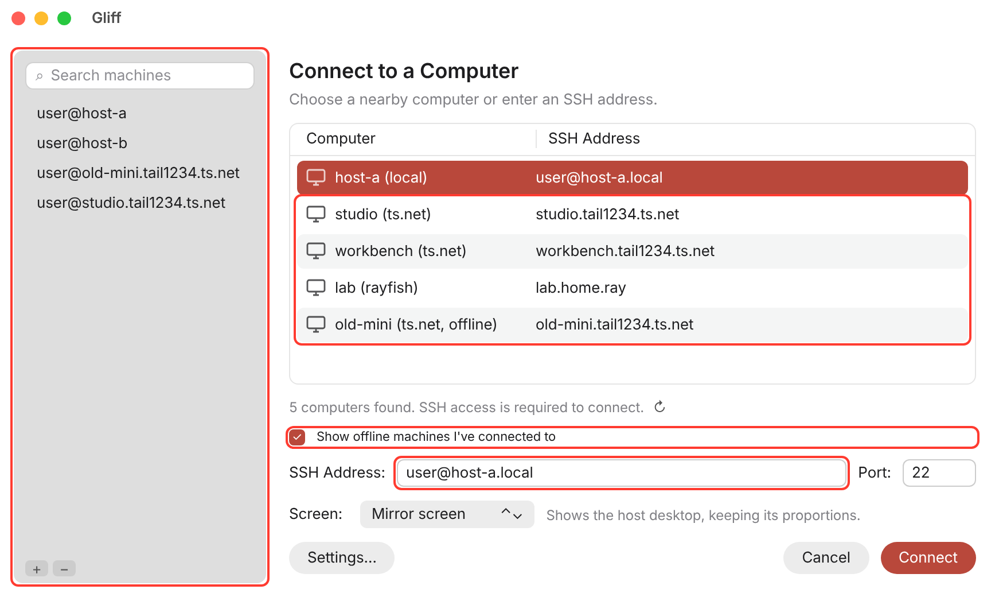
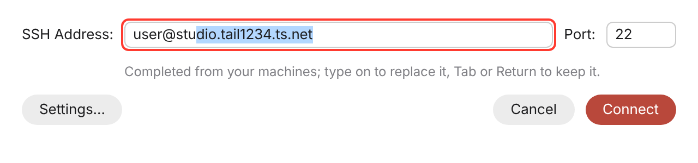
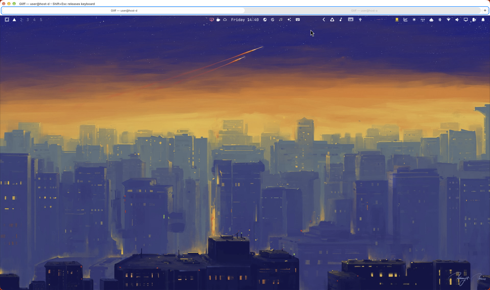
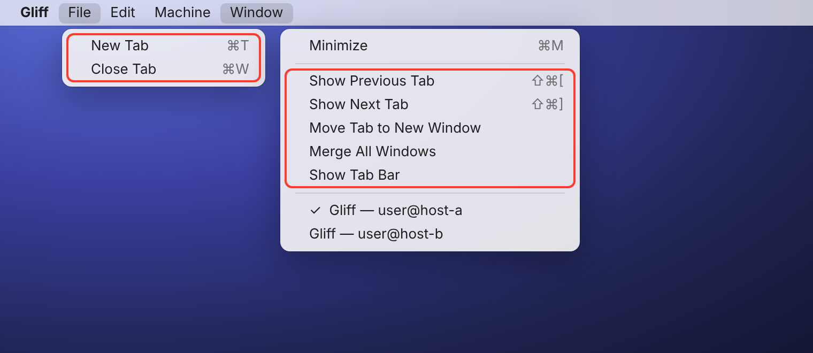
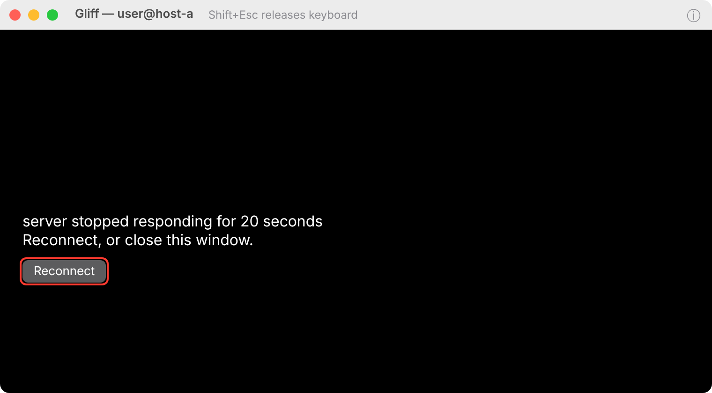
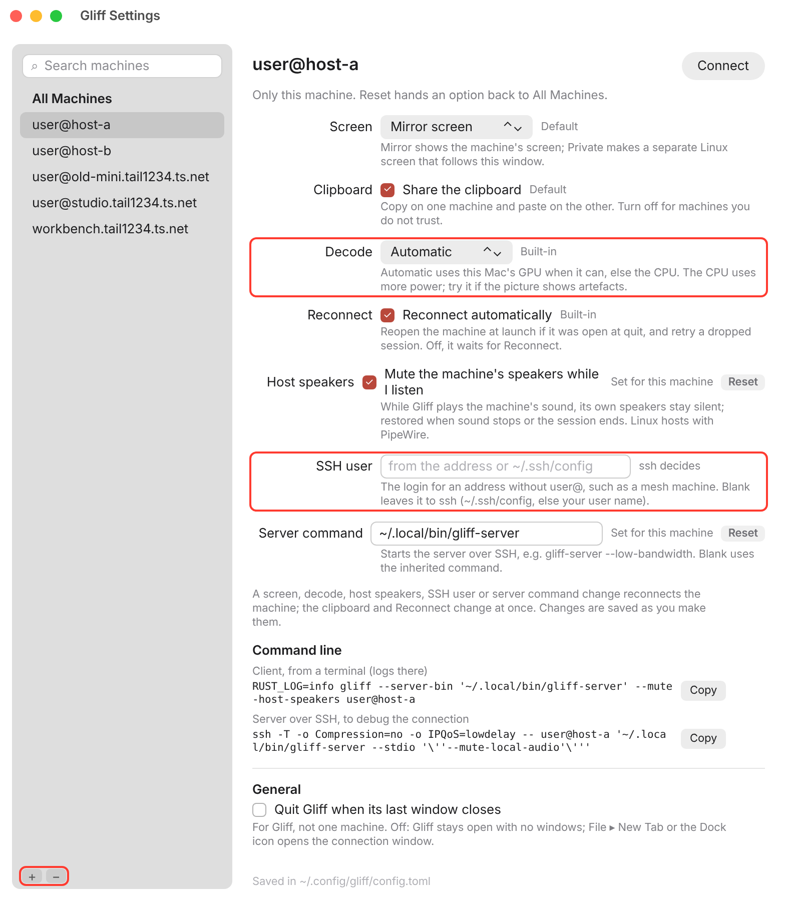
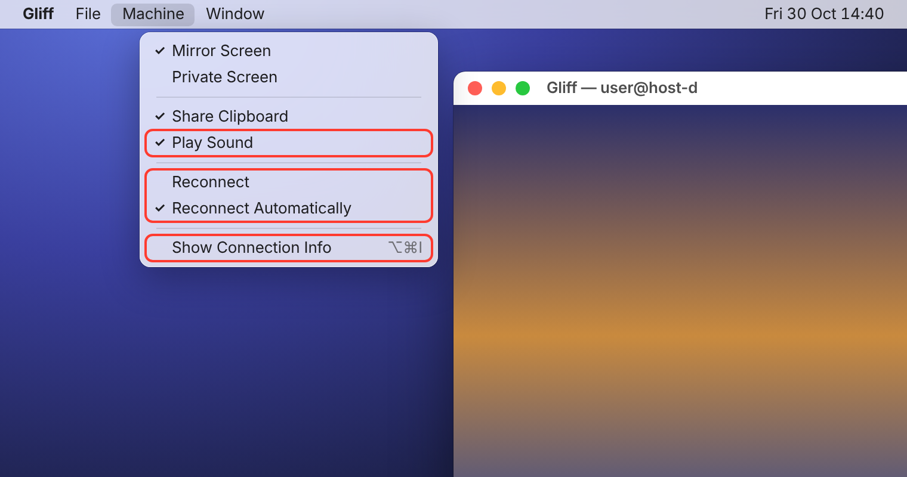

# gliff

[](https://github.com/omacom/gliff/actions/workflows/ci.yml)

gliff is a remote desktop for Hyprland and macOS. It shows the desktop of
another machine in a window on yours, and all it needs between the two is
ssh: no open ports, no accounts, no relay.

On Linux, full-resolution colour (4:4:4) keeps coloured text sharp, with
GPU video where supported and a CPU fallback. Mac hosts prefer hardware
H.264 through VideoToolbox; full-colour mode uses the CPU. Mac viewers
decode in hardware (VideoToolbox, with the 4:4:4 recombine in Metal) and fall
back to the CPU where that is unavailable.


## Contents

<!-- Generated from the headings; update it when a heading changes. -->

- [New in this fork](#new-in-this-fork)
  - [Upstream PRs included](#upstream-prs-included)
  - [Fork features](#fork-features)
  - [Screenshots](#screenshots)
  - [Status](#status)
- [What you get](#what-you-get)
- [Requirements](#requirements)
- [Install](#install)
  - [Build from source (this fork)](#build-from-source-this-fork)
  - [Upstream package](#upstream-package)
  - [macOS details](#macos-details)
  - [Arch Linux / Omarchy details](#arch-linux--omarchy-details)
  - [Make targets](#make-targets)
- [Use](#use)
- [If something does not work](#if-something-does-not-work)
- [Changes in this fork](#changes-in-this-fork)
  - [Upstream pull requests merged](#upstream-pull-requests-merged)
  - [macOS](#macos)
  - [Build and checks](#build-and-checks)
- [More](#more)

## New in this fork

This fork ([LaurentFough/gliff](https://github.com/LaurentFough/gliff)) builds on acrogenesis' macOS client and host and adds the features below. See [ForkNews.md](ForkNews.md) for more details, and [ToDone.md](ToDone.md) for the full state and log; the detailed notes are under [Changes in this fork](#changes-in-this-fork).

<!-- The same list as ForkNews.md: update both together. -->

### Upstream PRs included

- **#47**: native macOS client and host, LAN discovery (acrogenesis). The base of the fork.
- **#98**: settings window and per-machine tab menu. Merged, and brought to the Mac client.
- **#80**: sound from Linux hosts (Opus over the existing connection). Merged.
- **#5**: dhh's macOS client. Only its VideoToolbox + Metal video path, ported into #47's viewer.

### Fork features

- **Tabs on the Mac**: every connection is a native macOS tab in one viewer. The tab bar's **+** or File ▸ New Tab adds a machine; tabs stay connected, only the visible one plays sound, and open tabs reopen at launch. *(Tested.)*
- **Known machines in the connection window**: a sidebar lists every machine you have connected to (searchable, **+** to add one, **−** to forget one), and the SSH Address field autocompletes from them, at launch and for File ▸ New Tab. *(Tested.)*
- **Per-machine auto-reconnect**: Machine ▸ Reconnect Automatically, or Reconnect in Settings on both clients (`auto_reconnect`; Settings ▸ Reconnect on Linux). Off, the machine is not reopened at launch and a dropped session waits for Reconnect. *(Tested.)*
- **One app on the Mac**: Settings and the connection window (at launch and File ▸ New Tab) open inside the viewer (one Dock icon and ⌘-Tab entry, one menu bar from the start; Settings' Connect also answers an open connection window: launch fix testing pending). New Tab is a sheet over a tab that is not connected, else its own window; ⌘, brings an open Settings forward, and Settings can **Connect** a machine (or double-click it) in a new tab. The connection window's list grows with the window. *(Tested.)*
- **Quit on last window, and About**: Settings ▸ General ▸ Quit Gliff when its last window closes (`quit_on_last_window`, default off: Gliff stays open, and ⌘T or the Dock icon opens the connection window). Gliff ▸ About Gliff shows the version and build (commit, arch). *(Tested.)*
- **Reconnect on the Mac**: a dropped or failed session shows a **Reconnect** button; sessions that had connected retry automatically (5 × 1.5 s, as on Linux), without repeating SSH prompts. *(Tested.)*
- **GPU video on the Mac viewer**: VideoToolbox hardware H.264 decode, Metal 4:4:4 recombine, `CAMetalLayer` presentation; asks for 4:4:4 first, falls back to OpenH264 (`--video cpu` forces it). 4K 4:4:4: about 6.9 ms per frame on the GPU vs 18.8 ms on the CPU.
- **Sound from a Mac host**: a Mac host sends what it plays (ScreenCaptureKit system audio, coded as Opus on #80's wire) while a client plays it; Linux and Mac clients hear it. Host speakers does not mute a Mac host yet. *(Tested 2026-11-03: Mac → Mac.)*
- **SSH user**: a per-machine (or default) `ssh_user` in both clients' Settings, used for an address without `user@` (mesh machines report none); mesh rows also take the user of a known `user@host` machine. *(New; testing pending.)*
- **Machines in Mac Settings**: **+** / **−** under the Settings list add a machine by its SSH address or forget one; **Connect** shows a machine's tab when it is already open. *(New; testing pending.)*
- **Decode in Mac Settings**: Settings ▸ Decode per machine: Automatic, GPU (VideoToolbox + Metal) or CPU (OpenH264), the client's `--video`. *(Tested 2026-11-03.)*
- **Connection Info on the Mac**: the ⓘ title-bar button or Machine ▸ Show Connection Info (⌥⌘I) shows a translucent panel over each tab: stream size and colour, GPU/CPU tiers, fps, Mbit/s, decode time, round trip, sound buffer, and the client's and viewer's CPU use. *(Tested 2026-11-03.)*
- **Sound on the Mac viewer**: plays Linux hosts' sound through #80's `gliff-audio` (CoreAudio). **Machine ▸ Play Sound** shares the Linux client's mute switch; `--no-audio` starts muted.
- **Host speaker mute**: `gliff-server --mute-local-audio` mutes the Linux host's speakers while the client plays, and restores them on stop, disconnect or crash. Per machine in Settings on both clients (`mute_host_speakers`). *(Tested.)*
- **Shared settings**: a `gliff-settings` crate; both clients read and write `~/.config/gliff/config.toml`. On the Mac: a settings window (⌘,) and a Machine menu. Both settings windows offer Reconnect, Host speakers and the Command line.
- **Local signing**: no paid Apple Developer account needed (a self-signed `gliff-local` identity), so privacy permissions survive rebuilds.
- **Makefile**: one front end for `bin/` and `scripts/`. `make macos` builds, signs, installs and verifies; `make install` on Arch; also `make check`, `make video-check` and `make distclean`; a project-wide `.gitignore`.
- **Build once, install on other Macs**: `make install` skips an unchanged build (a build ID in the app); `make install-package` installs a ZIP from another Mac and re-signs it locally; `make release-upload` / `make install-release` carry it through GitHub Releases. Apple Silicon. *(Tested.)*
- **Build once, install on other Arch/Omarchy machines**: the same `make package` / `install-package` / `release-upload` / `install-release` with a pacman package (`PKG=`, `linux-COMMIT` releases); `make install` skips an unchanged build. *(Tested.)*
- **Command line in Settings**: each machine's client command (`RUST_LOG=info gliff [flags] user@host`) and the exact ssh server command, with Copy, in both clients' Settings, for running or debugging a connection from a terminal; new `--mute-host-speakers` flag. *(Tested.)*
- **Mesh VPN machines**: peers from Tailscale/Headscale and Rayfish, for hosts mDNS cannot reach: listed as `hostname (ts.net)` / `hostname (rayfish)` in the Mac connection window after the nearby `hostname (local)` computers, and in a menu by the Linux address bar; choosing one connects. Online machines only, with a "Show offline machines I've connected to" checkbox; `gliff --mesh` prints a table (`--offline`, `--json`). *(Tested.)*
- **Releases built by CI**: `make release-ci` runs the fork's "Fork builds" workflow on GitHub Actions for the pushed branch (checks, Mac ZIPs for Apple Silicon and Intel, the Arch package) and publishes one `build-COMMIT` pre-release that `make install-release` finds on either system. *(New; the first run passed: `build-c331ac1b2d81`. Installing from it is still to test.)*
- **Checks**: `make video-check` checks GPU output against the CPU decoder and benchmarks both; the ssh login-shell test no longer depends on your shell setup; `scripts/check.sh` stops early on a Rust older than `rust-version` (1.87); `rust-toolchain.toml` pins Rust 1.99.0 for rustup; the Mac crate is clippy-clean on Linux too (as CI lints it).
- **Fixes**: Mac install and signing (`plutil`, a custom cargo `target-dir`); the client ignores stray sound packets from a host; Arch installs run `pacman -U` through doas, sudo or su (`GLIFF_AUTH`, else `PACMAN_AUTH`); the Arch package tells you to run `gliff-enable-discovery`, which nearby-computer discovery needs.
- **Planned**: an iOS/iPadOS client; see [docs/feature-future/ios-ipados-plan.md](docs/feature-future/ios-ipados-plan.md). Several clients on one desktop (hardening, view-only, a shared stream); see [docs/feature-future/multi-client-plan.md](docs/feature-future/multi-client-plan.md).

### Screenshots

The new features are outlined in red. The connection and Settings windows are rendered mockups drawn to match the code (`docs/images/src/`), with placeholder machines.

**Connection window:** known machines in a sidebar (search, **+** to add, **−** to forget); the SSH Address field autocompletes from them. Mesh peers (Tailscale/Headscale `ts.net`, Rayfish) are listed by hostname with their source, and **Show offline machines I've connected to** adds known peers that are offline.



**Address autocomplete:** typing completes from your machines (the newest match), with the added part selected: type on to replace it, Tab or Return to keep it.



**Tabs:** this shows two tabs in one window, one connection each (outlined separately). Any number of tabs is supported: **+** or File ▸ New Tab opens another connection.



**File and Window menus:** New Tab (⌘T) and Close Tab (⌘W); Show Previous/Next Tab, Move Tab to New Window, Merge All Windows and Show Tab Bar. (Both drawn open here; macOS opens one at a time.)



**Reconnect:** a dropped session that could not be resumed (or with Reconnect Automatically off) waits with the error and a **Reconnect** button.



**Settings:** per machine, or for all machines: **+** / **−** to add a machine by its SSH address or forget one, **Connect** from the selected machine (or show its tab when it is open), **Decode** (Automatic, GPU or CPU), **SSH user** (the login for an address without `user@`, such as a mesh machine), **Reconnect automatically**, **Host speakers** (mute the machine's speakers while you listen), the **Command line** that reproduces the machine's settings (client and server over SSH, each with Copy), and **General ▸ Quit Gliff when its last window closes**.



**'Machine' menu:** Play Sound, Reconnect, Reconnect Automatically and Show Connection Info (⌥⌘I).



### Status

| Path | State |
|---|---|
| Linux host → Mac client | Tested: GPU video, sound, host mute |
| Mac tabs: several connections at once | Tested (2026-10-30) |
| Mac tabs: sound, clipboard, Machine menu, Window menu, restore at launch | Tested (2026-10-30) |
| Mac reconnect | Tested (2026-10-30) |
| Known machines (sidebar, + / −, autocomplete) | Tested (2026-10-30) |
| Per-machine auto-reconnect | Tested on the Mac and Linux (2026-10-31) |
| #98 settings on the Linux client | Tested (2026-10-31) |
| Mac: Settings and New Tab in the viewer, Connect from Settings | Tested (2026-10-31) |
| Mac: quit on last window, About Gliff | Tested (2026-10-31) |
| Mac discovery (Bonjour) | Tested (2026-10-30); the host must run `gliff-discovery` (`gliff-enable-discovery`) |
| Linux host → Linux client sound | Tested (2026-10-31) |
| Build once, install elsewhere: Mac and Arch/Omarchy | Tested (2026-10-31) |
| Host speakers setting, Reconnect in the Linux settings | Tested (2026-11-01) |
| Command line in Settings | Tested (2026-11-02) |
| Mesh VPN machines (Tailscale/Headscale, Rayfish), `gliff --mesh` | Tested (2026-11-03) |
| Releases built by CI (`make release-ci`) | First run passed (all three packages published); `make install-release` not tested yet |
| Intel Mac packages | Built by CI; not tested on an Intel Mac |
| SSH user, Settings + / −, Connect to an open tab | Built; testing pending |
| Decode in Mac Settings | Tested (2026-11-03) |
| Connection Info overlay (Mac) | Tested (2026-11-03) |
| Sound from a Mac host | Tested Mac → Mac (2026-11-03); Mac → Linux to confirm |

## What you get

- Mirror a physical screen on either platform. Hyprland hosts also provide
  private screens that follow the size of your window.
- Remote keyboard, mouse and scrolling. Linux and Mac clients send their
  keyboard layout to Hyprland hosts. Mac hosts use their active local layout.
- Shared text clipboard in both directions. Linux-to-Linux sessions also
  transfer images and copied files.
- Sound from Linux hosts to Linux and Mac viewers, in both directions at
  once without echo, so two machines can show each other. Mac hosts do not
  send sound yet.
- Linux hosts adapt quality to the link, giving up frame rate before sharpness.
- Linux viewers provide tabs, reconnection, and your Omarchy theme. Mac
  viewers use native macOS tabs and reconnect after a dropped session.

## Requirements

- Linux with Hyprland, or macOS 13 Ventura or later, on either end.
- A logged-in desktop session on the remote machine. On a Mac host, grant
  Screen Recording and Accessibility to Gliff.
- For sound from a Linux host: PipeWire (`pw-record`, `pw-dump`, `pw-link`),
  or PulseAudio's `parec`. A Linux viewer plays through its ALSA default
  device; install `pipewire-alsa` or `pulseaudio-alsa` to route it through
  your sound server.
- ssh access from your machine to the remote one.
- For GPU video: an AMD or Intel GPU with its Vulkan and VA-API drivers
  (on Arch, `vulkan-radeon` and `mesa` for AMD, or `vulkan-intel` and
  `intel-media-driver` for Intel). Without them, and on NVIDIA, gliff uses
  the CPU and needs nothing extra.

## Install

Install gliff on both machines: your machine runs `gliff`, the remote one
runs `gliff-server`.

### Build from source (this fork)

This fork's features come only from building it (or from its releases, see
"build once" below). Clone it once; its default branch,
`acrogenesis/macos-client-host`, is the working branch:

```
git clone https://github.com/LaurentFough/gliff.git
cd gliff
```

**macOS** (13 Ventura or later; Apple Silicon is tested). Install the Xcode
Command Line Tools and Rust (rustup reads the repository's
`rust-toolchain.toml` and fetches the pinned version), then build, sign,
install and verify:

```
xcode-select --install                                           # once
curl --proto '=https' --tlsv1.2 -sSf https://sh.rustup.rs | sh   # once, or: brew install rustup && rustup-init
make macos
```

**Arch Linux / Omarchy** (x86_64). Install the build tools, then build the
package and install it (`makepkg` fetches the other build dependencies;
`pacman -U` runs through sudo, doas or su):

```
sudo pacman -S --needed base-devel git    # once
make install                              # or: bin/install
gliff-enable-discovery                    # on a host the Mac should find on the LAN
```

`make check` (`scripts/check.sh`) runs the CI checks before you push;
`make help` lists every target. The sections below cover each platform's
details.

### Upstream package

Upstream gliff is on the **edge** channel of the [Omarchy Package
Repository (OPR)](https://github.com/omacom/omarchy-pkgs). It installs
upstream's release, **without this fork's features**:

```
omarchy pkg add gliff
```

Then open **Gliff** from the app launcher, or run `gliff` in a terminal.

### macOS details

On macOS, build and install the native app from this checkout (Rust and
Xcode Command Line Tools are required; an Apple Developer Program membership
is not):

```
make macos            # create a local signing identity once, build, sign, install, verify
make macos CHECK=1    # the same, running the CI checks first
```

`make macos` runs `bin/setup-macos-signing`, `bin/install-macos` and
`make verify` in that order. The first run creates a self-signed
`gliff-local` code-signing identity in your login keychain and asks for your
password once, to trust it for code signing; later runs reuse it. Signing
every build with the same identity keeps the Screen Recording, Accessibility
and Local Network grants across rebuilds, which ad-hoc signing does not.
`SIGNING=0` skips the identity and signs ad-hoc. Without make:

```
bin/setup-macos-signing   # once
bin/install-macos
```

The installer picks its signing identity in this order:
`GLIFF_CODESIGN_IDENTITY` (a 40-digit SHA-1 fingerprint), the identity saved
in the installed app, `gliff-local`, an "Apple Development" certificate (a
free Apple ID in Xcode › Settings › Accounts provides one), then ad-hoc. Such
builds run on Macs that trust the certificate; builds for other people need
Developer ID signing and notarization (`make package-release`, see
[macOS support](docs/macos.md)).

**Other Macs: build once.** `make install` skips an unchanged build, so
re-running it is cheap. To put the same build on more Apple Silicon Macs
without building there, either copy a package or go through GitHub Releases
(the other Mac needs a clone of this repository for its `make` targets, but
not Rust or Xcode):

```
# Build Mac                                 # Other Mac
make package                                make install-package ZIP=path/to/gliff-…-macos-arm64-development.zip
make release-upload   # needs gh            make install-release            # newest macos-* release
```

Each install re-signs the app with that Mac's own identity and verifies it;
About Gliff shows the build ID. The full procedure, options and checks are in
[macOS support › Build once, install on other Macs](docs/macos.md#build-once-install-on-other-macs).

This installs `~/Applications/Gliff.app`, with `gliff` and `gliff-server`
links in `~/.local/bin`; `make verify` checks the signature and the links. Open the app to select a nearby computer or enter an
SSH address, or run:

```
~/.local/bin/gliff user@omarchy-host
~/.local/bin/gliff-server --permissions --request  # enable Mac hosting
```

Enable Gliff in **System Settings → Privacy & Security → Screen & System
Audio Recording** (called Screen Recording on older releases) and
**Accessibility**. Reconnect after granting permission. From Omarchy:

```
gliff user@mac-host
```

SSH finds the installed Mac app even when its non-interactive PATH does not
include `~/.local/bin`. See [macOS support](docs/macos.md) for display selection,
installation, testing, and the current feature differences.

The Mac app discovers nearby Gliff desktops through Bonjour on the same local
network. Allow Local Network access if macOS asks. Linux packages advertise
logged-in desktops through an Avahi publisher tied to the desktop session;
Avahi and SSH must be running. For a source/development installation, enable
advertisement as your desktop user:

```
bin/enable-discovery
```

The installed equivalent is `gliff-enable-discovery`. Add `--ssh-port 2222`
if SSH uses a different port, or `--disable` to stop advertising. Discovery
lists computers; selecting **Connect** starts the SSH and desktop session.
SSH host confirmation and authentication use native prompts on the Mac.

### Arch Linux / Omarchy details

`make install` (or `bin/install`) builds the package from the current
checkout and installs it, as under [Build from source](#build-from-source-this-fork).
It skips an unchanged build: the package
records its build ID in `/usr/share/gliff/build-id`; `FORCE=1` rebuilds.

**Other Arch/Omarchy machines: build once.** Build the package on one
machine and install it on the others without Rust (they need a clone of this
repository for the `make` targets, and pacman fetches the runtime
dependencies):

```
# Build machine                              # Other machine
make package                                 make install-package PKG=path/to/gliff-…-linux-x86_64-….pkg.tar.zst
make release-upload   # needs gh             make install-release            # newest linux-* release
```

`make package` writes `target/linux/gliff-VERSION-linux-ARCH-COMMIT.pkg.tar.zst`
and its `.sha256`; `install-package` checks the checksum, the package name and
the architecture, skips a build that is already installed (`FORCE=1`
reinstalls) and runs `pacman -U` as root: through `GLIFF_AUTH` (e.g.
`GLIFF_AUTH=doas`), else `PACMAN_AUTH` from `makepkg.conf`, else sudo, doas
or su. Releases go to the fork as
pre-releases tagged `linux-COMMIT`, next to the Mac's `macos-COMMIT`
(`REPO=owner/name` for another repository; remove one with
`gh release delete linux-COMMIT --cleanup-tag`). Afterwards, run
`gliff-enable-discovery` on a host that should be found on the LAN.

**Or let GitHub build them.** `make release-ci` (from any machine with `gh`)
starts the fork's "Fork builds" workflow for the current branch, once it is
committed and pushed: it runs the checks, builds the Mac ZIPs (Apple Silicon
and Intel) and the Arch package, and publishes them together as a
pre-release `build-COMMIT`. `make install-release` on a Mac or an
Arch/Omarchy machine then picks the newest `build-*` (or `macos-*` /
`linux-*`) release. The workflow can also be started from the Actions tab
(Fork builds ▸ Run workflow).

For the build layout, development builds and testing tools, see
[docs/development.md](docs/development.md) (upstream's guide; it applies to
this fork too).

### Make targets

The `Makefile` is a front end for the scripts in `bin/` and `scripts/`: each
target calls the script that does the job, with the arguments it expects.
`make` lists them. Output goes to the terminal and to
`target/logs/<target>.log`; `SYSLOG=1` also logs each step's start and result
to syslog, and `V=1` shows the commands. Platform-specific targets stop with a
message on the other platform, and a failing script fails the target with its
exit status.

| Target | Runs |
|---|---|
| `make doctor` | tool check, cargo output directory, signing setup |
| `make build` | `bin/build` |
| `make check` / `make fix` | `scripts/check.sh` / `scripts/check.sh --fix` |
| `make test` | `cargo test --workspace --locked` |
| `make e2e` | `scripts/e2e.sh` (Linux, inside Hyprland) |
| `make install` | `bin/install`: the Mac app on macOS, `makepkg` on Arch; both skip an unchanged build (`FORCE=1`) |
| `make macos` | macOS: `signing`, `check` with `CHECK=1`, `install`, `verify` |
| `make signing` / `make signing-show` | `bin/setup-macos-signing` / its `--show` |
| `make app` | `bin/build-macos-app` into `target/macos/Gliff.app` (`APP=`, `SIGN_MODE=`) |
| `make verify` | checks the installed app's signature and `~/.local/bin` links |
| `make video-check` | checks the viewer's GPU video and compares GPU and CPU decode times (`ARGS="--cases 1080p-444"`) |
| `make package` | macOS: `bin/package-macos --development`, an ad-hoc signed ZIP; Arch: `bin/package-linux`, a pacman package; each with its checksum (`OUT=`) |
| `make install-package` | installs a `make package` file from another machine (`ZIP=` on macOS, re-signed locally; `PKG=` on Arch, `pacman -U`): checks the SHA-256 (`FORCE=1`) |
| `make release-upload` | publishes this commit's package as a GitHub release, `macos-COMMIT` or `linux-COMMIT` (`TAG=`, `ZIP=`/`PKG=`, `REPO=`; needs `gh`) |
| `make install-release` | downloads and installs the newest release for this system (`TAG=`, `REPO=`, `FORCE=1`) |
| `make release-ci` | builds every package on GitHub Actions (Mac Apple Silicon and Intel, Arch x86_64) for the current pushed branch and publishes them as one pre-release `build-COMMIT` (`BRANCH=`, `INTEL=0`, `CHECKS=0`, `WATCH=0`; needs `gh`) |
| `make package-release` | `bin/package-macos`: Developer ID, notarized (`GLIFF_NOTARY_PROFILE`) |
| `make icon` | `bin/export-macos-icon` |
| `make dev` / `make install-dev` | `bin/dev` / `bin/install-dev` (Linux) |
| `make discovery` / `make discovery-off` | `bin/enable-discovery` (`SSH_PORT=`) / `--disable` |
| `make clean` | `cargo clean` |
| `make distclean` | removes everything `.gitignore` ignores (`target/`, stray logs, `.DS_Store`, `patch/`): lists it, then asks (`FORCE=1` skips) |

Pass extra script or cargo arguments with `ARGS`, for example
`make build ARGS="-p gliff"`. The Makefile works with the GNU make 3.81 that
macOS ships.

## Use

```
gliff user@host
```

This mirrors the screen that has focus on the remote machine. To pick a
screen, or to get a private one:

```
gliff --output DP-1 user@host   # mirror a named remote screen
gliff --headless user@host      # a private remote screen, sized and
                                # scaled to this window
```

A mirrored screen keeps its own size and is fitted into the window. A private
screen follows the window as you resize it, and is removed when you
disconnect.

To see the machines on your mesh VPNs (Tailscale/Headscale, Rayfish), the
same ones the connection window lists:

```
gliff --mesh             # online machines: hostname, IP, source, address, state
gliff --mesh --offline   # offline ones too
gliff --mesh --json      # JSON
```

On Linux, every machine you connect to gets a tab in the title bar. Click a tab to
connect to that machine, or to switch to it: each connection keeps running
while you look at another, so switching is instant. Hover a tab for its
button: a stop square disconnects a running machine, and an X forgets one
that is not running. Drag the tabs to reorder them. The + after the tabs
opens the address bar; type `user@host` and press Enter to add a machine.
A bare `gliff` opens the window with a tab for each machine you have used,
and connects again to the ones that were connected when you closed it; with
no machines yet, it opens with the address bar ready.

**Keyboard.** While the pointer is over the picture, everything you type goes
to the remote machine, window-manager shortcuts included; move the pointer
off it to get your own back. Press `Shift+Esc` to get your shortcuts back
without moving the pointer. `--release-hotkey` changes that key (`ctrl+alt+q`,
`double-escape`, or `none`).

**Clipboard.** On Linux, copy on one machine and paste on the other. A copy announces
only its types, and the contents are sent when the other side asks for them,
normally when you paste. A paste that takes more than a second shows its
progress with a cancel button. Pasted files are kept in `~/.cache/gliff/clipboard`.

What you copy locally is offered only to the machine in the tab you are
looking at. Switching tabs withdraws it from the old machine and offers your
current clipboard to the new one.

Clipboard sharing trusts the host you are looking at: it can request the
advertised clipboard contents without a local paste. Use `gliff --no-clipboard`
to disable sharing in both directions when connecting to an untrusted host.
Local selections marked `x-kde-passwordManagerHint` are not shared.

Changing the clipboard cancels unfinished pastes from this machine to the
remote host. Wait for a file paste to finish before copying something else. Switching
tabs also cancels unfinished pastes to the tab you leave.

**Sound.** The window plays the sound of the machine it shows. The speaker
button in the header mutes it and remembers that; `gliff --no-audio` starts
muted. Only the tab you look at plays, and other tabs' hosts stop recording.
A host with PipeWire's `pw-record` and `pw-dump` sends what its applications
play except Gliff itself, so when two machines show each other, neither hears
its own sound come back. A host missing either sends its whole output, Gliff
included, and two such machines that show each other echo; mute one side to
stop it. Hosts keep playing their sound on their own speakers, unless the
machine's **Mute the machine's speakers** setting is on (Settings ▸ Sound on
Linux, Settings ▸ Host speakers on the Mac; `mute_host_speakers`, which runs
`gliff-server --mute-local-audio`): then the host's speakers are muted while the client
plays its sound and restored when sound stops or the session ends, even if
the server is killed. That needs PipeWire with WirePlumber on the host
(`pw-dump`, `pw-record`, `wpctl`). Sound is Opus
at 128 kbit/s, and the client buffers 40 to 250 ms of it, more on a jittery
link.

**Slow links.** gliff measures the link and lowers the frame rate, then the
colour detail, then the resolution, and raises them again when there is
room. Two flags change the video, and you pass them to the server through
`--server-bin`: `--low-bandwidth` sends 4:2:0 colour from the start, and
`--full-chroma` keeps 4:4:4 on a server that encodes on the CPU.

```
gliff --server-bin 'gliff-server --low-bandwidth' user@host
```

## If something does not work

- On Linux, run `gliff-probe all`. It checks the compositor, the GPU
  drivers and both video paths, and prints PASS or FAIL for each.
- If a Tailscale or Rayfish machine is missing from the connection window,
  `gliff --mesh --offline` shows what each client answered (not installed,
  timed out, failed with its error) and every machine it knows. Nearby
  machines need `gliff-enable-discovery` on the host.
- If ssh cannot find `gliff-server`, give its path:
  `gliff --server-bin /path/to/gliff-server user@host`.
- The server needs the remote user's running Hyprland session, which it
  finds under `XDG_RUNTIME_DIR`, or `/run/user/<uid>` when ssh does not set
  it. If the session is elsewhere, set it through
  `--server-bin 'env XDG_RUNTIME_DIR=/path gliff-server'`.
- To rule out a driver problem, force the CPU on your end with
  `gliff --video cpu user@host`.
- If the window connects but stays black, the remote GPU may allocate
  capture buffers it never fills (a VM's virtio-gpu with virgl, or a GPU the
  compositor does not render on). Have the compositor read the frames back
  instead: `gliff --server-bin 'gliff-server --capture shm' user@host`.
  The server then encodes on the CPU.
- Linux streams reduce screens wider than 4096 pixels. Mac hosting is capped
  at 1920×1200 and 30 fps.
- On macOS, `make doctor` shows the cargo output directory, the tools and the
  signing setup, and `make verify` checks the installed app. If macOS asks
  for Screen Recording or Accessibility again after every rebuild, the app is
  ad-hoc signed: run `make signing install`.
- A `build.target-dir` or `build.target` in `~/.cargo/config.toml`, or
  `CARGO_TARGET_DIR` / `CARGO_BUILD_TARGET`, moves cargo's output; the Mac
  app build asks cargo where the binaries are, so it works either way.

## Changes in this fork

This fork builds on
[acrogenesis/gliff `acrogenesis/macos-client-host`](https://github.com/acrogenesis/gliff/tree/acrogenesis/macos-client-host),
the macOS client and host (upstream PR #47), and adds the following.

### Upstream pull requests merged

- **#98, settings window and per-machine tab menu** (Linux client). Applied
  to this branch's Linux client, which lives in `crates/gliff/src/linux.rs`.
- **#80, sound from Linux hosts.** Opus over the existing connection, played
  through ALSA on Linux viewers. Mac hosts do not advertise sound; Mac
  viewers play it (see Sound on the Mac below).

Ported, not merged: #5 (dhh's macOS client, an alternative to #47's). Only
its VideoToolbox and Metal video path is taken; see GPU video below. Not
merged: #26 (HEVC for screens larger than H.264 allows, which predates
gliff 0.4.1).

### macOS

- **Tabs.** One viewer process hosts every connection as a native macOS
  tab (macOS only groups windows of one process); the tab bar's **+** or File
  ▸ New Tab opens the connection window for another machine. Every tab stays
  connected, only a visible tab plays sound, the clipboard and Machine menu
  follow the active tab, and open tabs reopen at launch (`[[open_tabs]]`).
  The Window menu lists the tab commands (Show Previous/Next Tab, Move Tab to
  New Window, Merge All Windows, Show Tab Bar). See
  [macOS support](docs/macos.md).
- **One app.** Settings and the connection window (at launch and File ▸ New
  Tab) are the viewer's own windows (one Dock icon, ⌘-Tab entry and menu
  bar), not separate helper processes; with no tab to reopen, the viewer
  starts without a window and shows the connection window. New Tab is a sheet over a tab without
  a live session and its own window over a connected tab (or with no tab);
  ⌘, brings an open Settings forward; Settings' **Connect** (or a
  double-click on a machine) opens it in a new tab. The connection window's
  nearby-computers list takes the height of a taller window.
- **Quit on last window.** Settings ▸ General ▸ Quit Gliff when its last
  window closes (`quit_on_last_window`, top-level in `config.toml`, default
  off). Off, closing the last tab leaves Gliff running, and ⌘T or the Dock
  icon opens the connection window; on, it quits and that machine reopens at
  the next launch.
- **About Gliff.** The Gliff menu shows the version and the build: the commit
  (`-dirty` for uncommitted changes) and architecture, or `GLIFF_BUILD_ID`
  from an installer.
- **Reconnect.** A failed or dropped session shows its error with a
  **Reconnect** button. A session that had connected retries automatically,
  5 times 1.5 s apart, as on Linux; a failed first connection waits, so a
  wrong password does not reopen the SSH prompt; an incompatible server is
  never retried.
- **Per-machine auto-reconnect.** A shared `auto_reconnect` setting (default
  on), switched with Machine ▸ Reconnect Automatically or the Reconnect row
  in Settings (both clients; the Linux settings window has a Reconnect
  group). Off, the machine is not reopened at launch and a dropped session
  waits for Reconnect, on either client. Changing it never reconnects a
  session.
- **Known machines in the connection window.** A sidebar lists every
  machine in `config.toml`'s `machines`, newest first, with a search field;
  choosing one fills the address and its screen, double-click connects, **+**
  adds the typed address and **−** forgets a machine (its settings and its
  tab to reopen too, as the Linux client's Forget). The SSH Address field
  completes from the same list as you type. At launch and for File ▸ New Tab.
  See [macOS support](docs/macos.md#known-machines-and-autocomplete).
- **Per-machine settings.** #98's settings model is a shared
  `gliff-settings` crate, so both clients read and write the same
  `~/.config/gliff/config.toml`. The Mac has a settings window (⌘,), a
  Machine menu in the viewer, `--no-clipboard`, clipboard changes that apply
  at once, and screen or server-command changes that reconnect in the same
  window. The connection window follows each machine's saved screen. See
  [macOS support](docs/macos.md#settings) and [docs/settings.md](docs/settings.md).
- **GPU video.** The viewer decodes in hardware with VideoToolbox,
  recombines 4:4:4 in Metal and presents through a `CAMetalLayer`, and asks
  hosts for 4:4:4 first. It falls back to OpenH264 without a hardware
  decoder or after repeated errors; `--video cpu` or `decode = "cpu"` forces
  it. `make video-check` checks the output and compares decode times (4K
  4:4:4: 6.9 ms GPU against 18.8 ms CPU). See
  [macOS support](docs/macos.md).
- **Mesh VPN machines.** The connection window (and, on Linux, a menu by
  the address bar) lists peers from Tailscale/Headscale and Rayfish, for
  hosts mDNS cannot reach: `tailscale status --json` / `ray status --json`
  through `gliff_transport::mesh`, with a timeout, skipped when the client
  is missing (Tailscale.app's CLI is asked with `TAILSCALE_BE_CLI=1`). The
  Computer column reads `hostname (local)`, `hostname (ts.net)` or
  `hostname (rayfish)`. Only online machines show; "Show offline machines
  I've connected to" adds offline known machines (`mesh_show_offline`,
  shared by both clients). `gliff --mesh` prints a table of the machines
  and each client's answer (`--offline`, `--json`). See
  [macOS support](docs/macos.md#machines-on-a-mesh-vpn).
- **Command line in Settings.** Both settings windows show what the selected
  machine's settings come to on the command line, with Copy: the client
  (`RUST_LOG=info gliff [flags] user@host`) and the exact ssh command that
  starts its server, to debug a connection by hand. Both clients gain
  `--mute-host-speakers`, so the client line can spell out every option.
- **Host speakers muted while streaming.** `gliff-server --mute-local-audio`,
  switched per machine with the shared `mute_host_speakers` setting (Settings
  on both clients, default off), mutes the Linux host's default output while
  a client plays its sound, follows
  a new default output, and restores what it changed on sound off, session end
  or a crash (a detached watchdog). Only when the host records each
  application directly (PipeWire), so the client never hears the mute.
- **Sound on the Mac.** The viewer plays a Linux host's sound with #80's
  `gliff-audio` (Opus, the jitter buffer, and a cpal player on CoreAudio).
  **Machine ▸ Play Sound** is the same `muted` switch as the Linux client's
  speaker button; `--no-audio` starts muted. See
  [macOS support](docs/macos.md#settings).
- **Signing without a paid developer account.** `bin/setup-macos-signing`
  creates, trusts and tests a self-signed `gliff-local` identity once, and
  `bin/install-macos` uses it (or an Apple Development certificate) so
  Screen Recording and Accessibility grants survive rebuilds.
- **Install fixes.** The installer reads the saved signing identity with
  `plutil` (a first install used to fail with `GLIFF_CODESIGN_IDENTITY must
  be a certificate SHA-1 fingerprint`), and the app build asks cargo where
  the binaries are (a moved target directory used to fail with
  `cp: target/release/gliff: No such file or directory`).

### Build and checks

- **Makefile**: one front end for `bin/` and `scripts/`, including the
  `make macos` pipeline, `make verify`, `make video-check` and `make
  distclean` (removes everything `.gitignore` ignores, after asking); see
  [Make targets](#make-targets).
- **Build once, install on other Arch/Omarchy machines**: `make package`
  builds a pacman package with its build ID (`/usr/share/gliff/build-id`),
  `make install-package PKG=` installs it elsewhere (SHA-256, name and
  architecture checked), `make release-upload` / `make install-release`
  use `linux-COMMIT` GitHub releases, and `make install` skips an unchanged
  build, as on the Mac. `bin/package-linux`, `bin/install-linux-package`,
  `bin/release-linux`, `bin/install-linux-release`; shared
  `bin/lib/build-id.sh` and `bin/lib/linux-install.sh`.
- **Build once, install on other Macs**: a build ID in the app
  (`GliffBuildID`, the same as About Gliff's) lets `make install` skip an
  unchanged build; `make install-package` installs a `make package` ZIP
  (SHA-256, quarantine, re-signed locally); `make release-upload` /
  `make install-release` go through GitHub Releases. Shared logic in
  `bin/lib/macos-install.sh`. See
  [Build once, install on other Macs](docs/macos.md#build-once-install-on-other-macs).
- **Releases built by CI**: `.github/workflows/fork-builds.yml` ("Fork
  builds"), started with `make release-ci` (`bin/release-ci`) or from the
  Actions tab, runs the checks and builds the Mac ZIPs (Apple Silicon and
  Intel) and the Arch package on GitHub's runners, then publishes one
  pre-release `build-COMMIT`; `make install-release` finds it on either
  system. Upstream's `ci.yml` is unchanged.
- **Rust version**: `rust-toolchain.toml` pins Rust 1.99.0 for rustup users;
  `scripts/check.sh` stops early, with how to update, when Rust is older
  than `rust-version` (1.87) instead of failing on a dependency.
- **Linux installs as root through your tool**: `pacman -U` runs through
  `GLIFF_AUTH`, else `PACMAN_AUTH` from `makepkg.conf`, else sudo, doas or
  su, so doas-only systems work; the package tells you to run
  `gliff-enable-discovery` after installing.
- **Project `.gitignore`**: Rust/cargo, Python, Swift/Xcode, logs, macOS
  clutter (`.DS_Store`), editors, packaging and local scratch (`patch/`).
- **ToDone.md**: a running report of this fork's state, pending work and a
  log of each commit or merge. **ForkNews.md**: the short list of what the
  fork adds, also at the top of this README.
- **Hermetic tests**: the ssh login-shell test runs each shell with an empty
  environment, so a developer's `ZDOTDIR`, `BASH_ENV` or `XDG_CONFIG_HOME`
  no longer breaks `scripts/check.sh`. The picker check also covers saved
  per-machine screens and the move of old picker preferences into the config,
  the nearby list growing with the window, and the windows opening inside the
  viewer. `gliff-macos` is clippy-clean on Linux, where CI lints it.
- **Screenshots** in the README (`docs/images/`, sources in
  `docs/images/src/`), and future-feature plans in `docs/feature-future/`.

## More

- [docs/architecture.md](docs/architecture.md): how it works, the design
  choices, measurements, and what is not built yet.
- [docs/hardware-quirks.md](docs/hardware-quirks.md): what each GPU driver
  and Hyprland do, and what is tested where.
- [docs/development.md](docs/development.md): building, running on one
  machine, and the tests.
- [docs/feature-future/ios-ipados-plan.md](docs/feature-future/ios-ipados-plan.md): this fork's plan for an
  iOS/iPadOS client (scope, effort, open decisions).
- [docs/feature-future/multi-client-plan.md](docs/feature-future/multi-client-plan.md): this fork's plan for
  several clients on one desktop (what works today, levels of work, decisions).

gliff is released under the MIT license.
